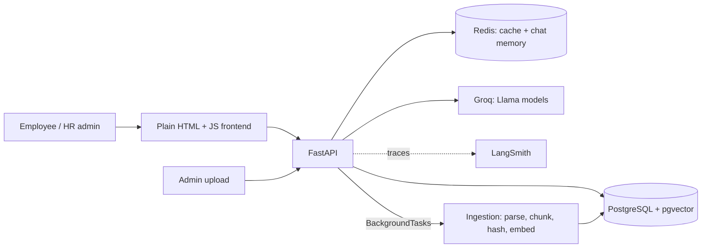

# PolicyBot

A Retrieval-Augmented Generation (RAG) assistant that answers employee questions **only** from official company policy documents. Every answer cites its source. If the answer is not in the documents, the bot says so and offers to escalate the question to HR instead of guessing.

> Sample data in this repo is fictional (Acme Technologies Pvt. Ltd.).

## What it does

- **Employees** log in and ask questions in a chat page ("How many casual leaves do I get?"). Answers show the document, section and page they came from.
- **HR admins** log in with the same account type, upload and manage policy documents, and answer escalated questions. Admins can also use the chat to test a new policy.
- **Stays on topic.** Coding help, general chat and jokes are refused. Prompt-injection attempts ("ignore your rules...") are refused too.
- **Never guesses.** If nothing relevant is retrieved, it replies: *"I don't know. I couldn't find this in the company policies. Please contact HR."* and shows an **Escalate to HR** button.

## Key features

| Area | What was built |
|---|---|
| Hybrid retrieval | Vector search (pgvector) + keyword search (Postgres full-text), merged with Reciprocal Rank Fusion, then reranked by a cross-encoder |
| Section-based chunking | One chunk per document section, so a rule stays with its exceptions |
| Incremental indexing | Each chunk is hashed; when a policy is re-uploaded, only changed chunks are re-embedded and removed chunks are deactivated (kept for audit) |
| Citations | Every answer lists document, section and page; answers without a valid citation are replaced with the "I don't know" message |
| Safe fallback | Similarity threshold, strict system prompt, temperature 0, and a citation check |
| Chat memory | Last 6 messages per session in Redis (30-minute TTL); follow-up questions are rewritten into standalone questions before retrieval |
| Caching | Redis answer cache keyed on the rewritten question; cleared whenever a policy changes; "I don't know" answers are never cached |
| Roles | One login; `admin` and `employee` roles; admins see an extra Admin tab |
| Escalation | Employees can escalate any answer to HR; HR replies from an admin tab; employees see replies under "My requests" |
| Observability | LangSmith tracing with a span per pipeline stage, plus per-stage latency returned by `/ask` |
| Evaluation | DeepEval with a Groq judge: the RAG triad plus contextual precision and recall, compared across three retrieval configs |
| Scalability | Stateless FastAPI app, shared Redis cache/memory, pgvector HNSW and GIN indexes, async LLM calls, per-user rate limiting, Docker Compose |

## Architecture



### How a question is answered (`POST /ask`)

1. Load the last messages for the session from Redis.
2. Rewrite the question into a standalone question (skipped if there is no history).
3. Check the cache. A hit returns immediately.
4. Retrieve: top 5 by vector search + top 5 by keyword search, merge with RRF, rerank, keep the best 3 (`is_active = true` only).
5. If the best score is below the threshold, return the fixed "I don't know" message without calling the LLM.
6. Generate the answer from the retrieved text only (Llama via Groq, temperature 0).
7. Check that the answer cites a retrieved chunk; otherwise return the fixed message.
8. Cache the answer, save the turn to history, and return the answer, sources and per-stage latency.

### How a policy upload works (`POST /admin/upload`)

1. Skip the whole file if its hash is unchanged.
2. Parse the PDF/DOCX into sections (heading, text, page), converting tables to markdown.
3. Chunk by heading; split sections over about 500 tokens; merge very short ones.
4. Normalize and hash each chunk's text (SHA-256, text only).
5. Compare with stored hashes: **same** is skipped, **new** is embedded and inserted, **missing** is deactivated.
6. Log `X skipped, Y added, Z deactivated` and clear the cache.

## Tech stack

| Layer | Choice |
|---|---|
| API | FastAPI (async), BackgroundTasks for ingestion |
| Orchestration | LangChain (LLM, prompts, splitter, retriever interface, reranker). LangGraph only if it keeps the `/ask` pipeline clearer |
| Database | PostgreSQL + pgvector (HNSW) + full-text search (tsvector + GIN) |
| Cache and memory | Redis |
| LLM | Groq: Llama 3.3 70B for answers, Llama 3.1 8B for rewriting |
| Embeddings and reranker | Configurable in `.env` (`EMBED_MODEL`, `RERANK_MODEL`): small local models, or a hosted API |
| Parsing | PyMuPDF (PDF), python-docx (DOCX) |
| Frontend | Plain HTML + JavaScript |
| Evaluation | DeepEval with a custom Groq judge |
| Observability | LangSmith |
| Deployment | Docker Compose (api, postgres, redis) |

## API

| Endpoint | Access | Purpose |
|---|---|---|
| `POST /login` | public | Returns a JWT that includes the role |
| `POST /ask` | admin, employee | `{session_id, question}` returns `{answer, sources, found, cached, latency_ms}` |
| `POST /escalate` | any logged-in user | Send a question to HR |
| `GET /my-escalations` | any logged-in user | See HR's replies |
| `POST /admin/upload` | admin | Upload or update a policy document |
| `GET /admin/documents` | admin | List documents |
| `DELETE /admin/documents/{id}` | admin | Remove a document |
| `GET /admin/escalations` | admin | List escalations |
| `POST /admin/escalations/{id}/reply` | admin | Reply to an escalation |
| `GET /health` | public | Health check |

## Database

- `users`: email, password hash, role
- `documents`: name, file hash, version, effective date, is_active
- `chunks`: text, chunk hash, section, page, embedding, tsvector, is_active
- `escalations`: user, question, bot answer, status, HR reply, timestamps

## Project structure

```
app/
  api/          routes, auth, rate limiting
  ingestion/    parser, chunker, hasher, incremental indexer
  retrieval/    hybrid retriever (vector + keyword + RRF + rerank)
  llm/          query rewriter, generator, scope check
  cache/        Redis cache and chat memory
  db/           models, migrations, seed
  eval/         eval helpers
eval/           dataset, DeepEval runner, Groq judge, results/
frontend/       login.html, chat.html, admin.html
documents/      sample policy files
tests/
docker-compose.yml
Dockerfile
requirements.txt
```

Adjust this tree to match your repository.

## Getting started

### Prerequisites
- Docker Desktop
- A Groq API key
- Optional: a LangSmith API key (tracing), a Cohere API key (if you use hosted embeddings)

### Configuration

Copy `.env.example` to `.env` and fill in the values. Never commit `.env`.

```
GROQ_API_KEY=
JWT_SECRET=
DATABASE_URL=
REDIS_URL=
EMBED_MODEL=
RERANK_MODEL=
VECTOR_K=5
KEYWORD_K=5
FINAL_K=3
SCORE_THRESHOLD=
CACHE_TTL=
MEMORY_TTL=1800
MEMORY_MESSAGES=6
LANGSMITH_TRACING=true
LANGSMITH_API_KEY=
LANGSMITH_PROJECT=policybot
```

### Run everything with Docker

```
docker compose up --build -d
docker compose logs -f api
```

### Develop without rebuilding

```
docker compose up -d postgres redis
# set the database and Redis hosts in .env to localhost
uvicorn app.main:app --reload
```

### First use

1. Open the app, log in as the seeded admin, and upload the files in `documents/`.
2. Ask a question in the chat page and check the cited sources.
3. To test incremental indexing, upload `01_leave_policy_v1.docx`, then `01_leave_policy_v2.docx`. Only the casual leave section changed, so the log should show 1 chunk added and 1 deactivated.

## Evaluation

The eval set has 25 questions: 13 in-scope, 3 multi-turn follow-ups, 5 whose answers are not in the documents, and 4 off-topic or prompt-injection.

```
python -m eval.run_deepeval --config vector_only   --dataset eval/dataset_25.json
python -m eval.run_deepeval --config hybrid        --dataset eval/dataset_25.json
python -m eval.run_deepeval --config hybrid_rerank --dataset eval/dataset_25.json
python -m eval.run_deepeval --compare
```

Metrics (0 to 1, judged by Llama on Groq): Answer Relevancy, Faithfulness, Contextual Relevancy (the RAG triad), Contextual Precision and Contextual Recall. Refusal accuracy for the not-in-documents and off-topic questions is reported separately.

### Results

Fill these in from `eval/results/` after running the evals. Do not publish numbers you have not measured.

| Config | Answer Rel. | Faithfulness | Ctx Relevancy | Ctx Precision | Ctx Recall | Avg latency (ms) |
|---|---|---|---|---|---|---|
| vector only | | | | | | |
| hybrid | | | | | | |
| hybrid + rerank | | | | | | |

Refusal accuracy: not-in-documents ___ / 5, off-topic ___ / 4.

### Latency

| Request | p50 | p95 |
|---|---|---|
| Cold cache | | |
| Cached | | |

## Limitations

- Digital PDF and DOCX only. Scanned files (OCR) are not supported.
- Heading detection works best on documents with real heading styles or numbered sections.
- Free-tier Groq limits apply, so evals run in small batches.
- The eval set is small, so scores are indicative, not statistically strong.
- LangSmith traces send prompts and retrieved text to its cloud. Do not enable it with confidential documents.
- No long-term memory, no OCR, no Kubernetes or multi-region setup.

## Possible next steps

- OCR for scanned policies
- Role-based access to specific policies
- Email notification for new escalations
- A larger eval set and automated eval runs in CI
-
